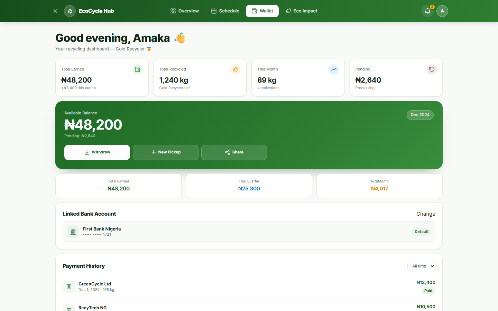
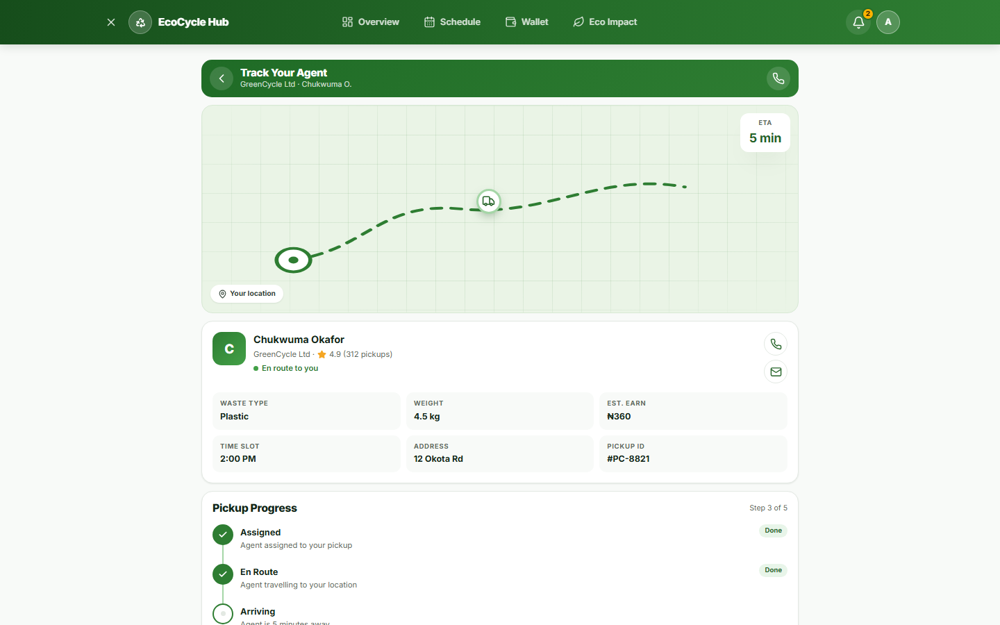

# EcoCycle Hub

**Turn waste into wealth & impact.** A Nigeria-focused recycling platform demo where households, businesses, schools and factories book doorstep pickups of recyclable waste — plastic, paper, metal, glass, organic, construction, textile and electronic — and get paid by weight straight to their bank. Pickup agents are tracked live, and a dashboard shows earnings, collection history, impact, and withdrawable balance.

**Live demo:** https://ecocycle-hub.vercel.app

## Screenshots

**Marketing site**

| Home | Categories |
|---|---|
|  |  |

**The app**

| Dashboard | Schedule a pickup |
|---|---|
|  |  |

| Wallet | Live agent tracking |
|---|---|
|  |  |

**Mobile**

| Home | Dashboard |
|---|---|
|  |  |


---

## What's inside

A complete, clickable product — marketing site plus the full consumer app. The public demo runs entirely in the browser with a localStorage store, and the same app can run against a real **Fastify + PostgreSQL** API in Docker (see [Backend](#backend-docker--postgresql)).

### Marketing site

- **Home** — hero with live phone mockup, stats, 8-step "how it works", earnings calculator, categories preview, impact numbers, recycled products, pricing, and six customer testimonials
- **Five dedicated pages behind the "Everything You Need" cards**, each with its own route, page title, sticky section switcher (mobile/tablet), and cross-links to sibling pages:
  - `/how-it-works` — the full pickup-to-payout journey
  - `/categories` — 8 waste categories with per-kg rates and detail view
  - `/impact` — platform-wide environmental and social impact
  - `/products` — what recycled waste becomes
  - `/pricing` — plans for individuals and businesses

### The app (two demo personas)

Click **Sign In** or **Create Account** — those are the only two doors into the dashboard.

| | **Sign In** | **Sign Up** |
|---|---|---|
| Persona | Amaka Obi, returning Gold Recycler | A brand-new empty account |
| Dashboard | ₦48,200 earned · 1,240 kg recycled · seeded collections | ₦0 with a 4-step onboarding checklist |
| Wallet | Balance, bank account, payout history | Honest empty states, "add payout account" |
| Eco Impact | Badges and impact history | Zero-state with guidance |

**App features**

- 4-step pickup scheduling (category → weight → date & time → review & confirm)
- Live agent tracking with ETA, agent card, and pickup progress stages
- Wallet with withdrawal flow (quick amounts, confirmation step, balance updates)
- Notifications panel with unread badge and "mark all read"
- Profile menu, bank account linking, pickup list with cancel/reschedule
- Fully responsive: tested at 360, 390, 768 and 1440 px

## Tech stack

- **React 19** + **TypeScript**
- **Vite 6** for dev/build
- **React Router 7**
- **lucide-react** icons
- Hand-written CSS design system (no UI framework) — forest/leaf/sky/earth palette
- State: React context, `localStorage` by default (`ecocycle-demo-v2`), or the REST API when `VITE_API_URL` is set
- Backend: **Fastify 5** + **PostgreSQL 16** + JWT auth, containerised with **Docker Compose**

## Getting started

```bash
npm install
npm run dev        # http://localhost:5173 (demo mode)
npm run build      # type-check + production build to dist/
npm run preview    # serve the production build
```

## Backend (Docker + PostgreSQL)

The API is a Fastify 5 service in `server/` backed by PostgreSQL 16. Both run in containers, so the host needs only Docker (with WSL 2 on Windows). Data is seeded automatically on first boot.

```bash
docker compose up -d --build     # db on :5436, api on :4001
curl http://localhost:4001/api/health
docker compose down              # stop (keep data)
docker compose down -v           # stop and wipe the database
```

From WSL on Windows, run the same commands from the repo directory:

```bash
wsl -d Ubuntu
cd /mnt/c/Users/Chizoba/Documents/Qoder/2026-11-14/2ed0a2eb
docker compose up -d --build
```

To point the frontend at the API, keep `.env.development` (already in the repo):

```
VITE_API_URL=http://localhost:4001
```

Restart `npm run dev` after changing it. Removing the variable — or building without it, as Vercel does — returns the app to localStorage demo mode. If the API is unreachable, the app probes `/api/health` at startup and falls back to demo mode automatically.

Seeded account: **amaka@gmail.com / demo1234** (Gold Recycler with history). New accounts start empty.

| Method | Endpoint | Purpose |
|---|---|---|
| `GET` | `/api/health` | liveness + database check |
| `GET` | `/api/categories` | waste categories and per-kg rates |
| `POST` | `/api/auth/signup` | create account, returns JWT + state |
| `POST` | `/api/auth/signin` | sign in, returns JWT + state |
| `GET` | `/api/me` | current snapshot (auth) |
| `GET`/`POST` | `/api/collections` | list / schedule a pickup (auth) |
| `PATCH`/`DELETE` | `/api/collections/:id` | reschedule/cancel (auth) |
| `POST` | `/api/wallet/withdraw` | withdraw to bank (auth) |
| `PUT` | `/api/bank-account` | update payout account (auth) |
| `POST` | `/api/notifications/read-all` | mark notifications read (auth) |
| `POST` | `/api/demo/reset` | restore the seeded state (auth) |

Every mutation returns the full updated snapshot (`{ state }`), which the frontend swaps in directly. Schema DDL and seed data live in `server/src/db.ts` and run idempotently at startup.

## Project structure

```
src/
├── App.tsx              # routes, marketing layout, header/footer, titles
├── data.ts              # categories, products, testimonials, plans, seed data
├── store.tsx            # app store: localStorage demo or REST API
├── styles.css           # design system + all component styles
├── components/          # AppShell, DashHeader, ExploreMore, UI primitives
└── pages/               # Home, HowItWorks, Categories, Impact, Products,
                         # Pricing, SignIn, SignUp, Dashboard, Schedule,
                         # Wallet, EcoImpact, TrackAgent
server/
├── src/index.ts         # Fastify bootstrap
├── src/db.ts            # schema, seed, snapshot queries
├── src/auth.ts          # JWT sign/verify + auth hook
└── src/routes/          # auth, collections, wallet, misc
docker-compose.yml       # db + api services
```

## Deployment

Deployed on **Vercel** at https://ecocycle-hub.vercel.app. Pushes to `main` deploy to production automatically. `vercel.json` contains the SPA rewrite so deep links (e.g. `/dashboard/wallet`) resolve correctly.

## Demo notes

- The public deployment is a front-end demo: no real accounts, payments, or pickups are created.
- Demo state is stored in your browser's `localStorage`; clear it to reset.
- Sign In loads the seeded "returning user" persona; Sign Up creates an empty persona.
- With the Docker backend running, accounts, pickups and withdrawals are real rows in PostgreSQL; the public deployment never points at it.
